# lmgcp — Google Cloud Platform Scripting Host for `lmscript`

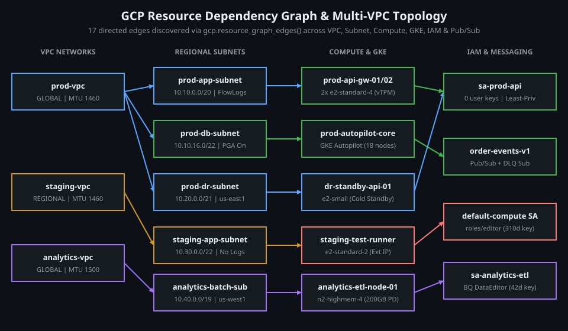
*Run this story: `lmctl https://raw.githubusercontent.com/lmctl-ai/lmgcp/main/examples/08_vpc_resource_topology_graph.lms` — Running this example costs about **$0.00** (read-only discovery; estimated from price table, not yet measured live; prices vary by region).*

**`lmgcp`** is a single-binary Google Cloud Platform (`cloud.google.com/go` + `google.golang.org/api`, Apache-2.0) scripting host built on [`lmcode-go`](https://github.com/lmctl-ai/lmcode-go) for `lmscript` (`lmctl`). It exposes **370 typed DSL signatures** across **16 Google Cloud services**—Compute Engine, VPC Networks/Subnets/Firewalls, Cloud Storage (GCS), Pub/Sub, Cloud Run v2, Cloud SQL, Cloud Firestore, BigQuery, IAM, Secret Manager (metadata-only), Cloud KMS, GKE, Artifact Registry, Cloud DNS, Cloud Logging, and Cloud Monitoring—with strict built-in **Cloud Safety & Cost Guardrails** and an in-process **Fake GCP REST Server** for zero-cost offline verification.

---

## Install lmctl

Everything in this repository runs through [lmctl](https://lmctl.com), the core tool of the lmctl family. Install it once, then run any `.lms` file or raw URL:

```bash
npm install -g @lmctl-ai/lmctl
lmctl autorun examples/01_project_inventory_overview.lms
lmctl autorun https://raw.githubusercontent.com/lmctl-ai/lmgcp/main/examples/01_project_inventory_overview.lms
```

## Visual Gallery (40 Self-Executing `.lms` Cloud Stories)

Every image below is generated directly by its `.lms` script in [`examples/`](examples/) against the deterministic in-process GCP REST emulator and rendered via [`lmdraw`](https://github.com/lmctl-ai/lmdraw). Every example measures its own cost using the `RunLedger` price table, enforces a per-example cost cap (default **`$0.05`**, hard ceiling **`$0.25`** per run), and prints `estimated cost: $0.00xx` (or `estimated cost: $0.00` for cost-free read-only stories) at the end. See [Cost per Example & Ledger Price Table](#cost-per-example--ledger-price-table) for how estimates are computed (`us-central1` list pricing; prices vary by region and change over time).

### 1. Multi-Service Estate Inventory & Resource Topology

| Estate Inventory Overview (`01`) | Label & Tag Compliance Audit (`02`) |
|---|---|
| 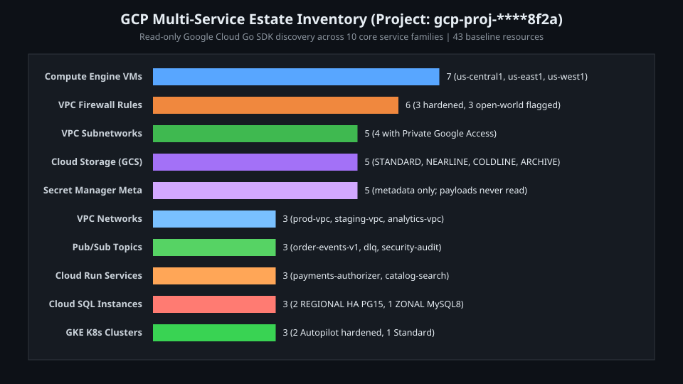<br>*`lmctl https://raw.githubusercontent.com/lmctl-ai/lmgcp/main/examples/01_project_inventory_overview.lms`*<br>Running this example costs about **$0.00** (`estimated cost: $0.00`, read-only; estimated from price table, not yet measured live; prices vary by region). | 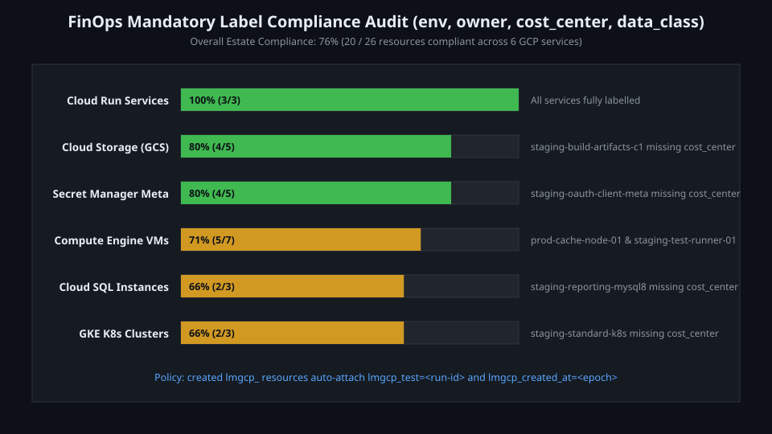<br>*`lmctl https://raw.githubusercontent.com/lmctl-ai/lmgcp/main/examples/02_label_compliance_audit.lms`*<br>Running this example costs about **$0.00** (`estimated cost: $0.00`, read-only; estimated from price table, not yet measured live; prices vary by region). |

| VPC Firewall Security Review (`03`) | Multi-VPC Topology & Dependency Graph (`08`) |
|---|---|
| 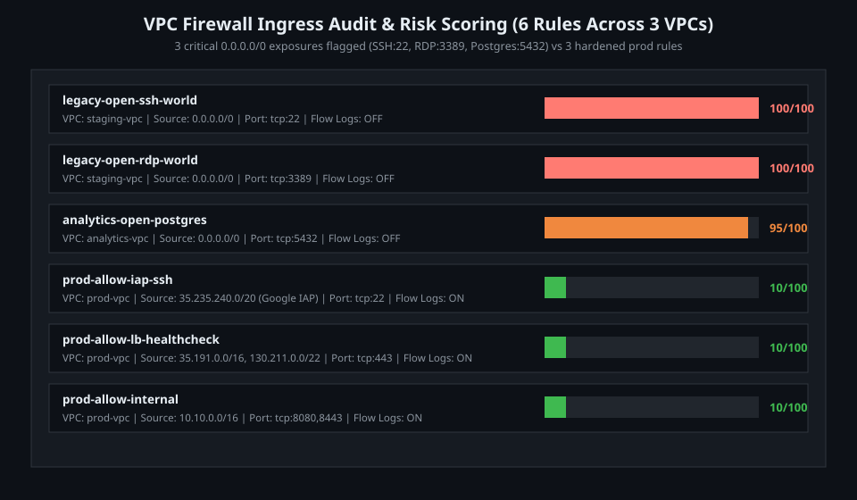<br>*`lmctl https://raw.githubusercontent.com/lmctl-ai/lmgcp/main/examples/03_vpc_firewall_security_review.lms`*<br>Running this example costs about **$0.00** (`estimated cost: $0.00`, read-only; estimated from price table, not yet measured live; prices vary by region). | <br>*`lmctl https://raw.githubusercontent.com/lmctl-ai/lmgcp/main/examples/08_vpc_resource_topology_graph.lms`*<br>Running this example costs about **$0.00** (`estimated cost: $0.00`, read-only; estimated from price table, not yet measured live; prices vary by region). |

| Compute Persistent Disk & Boot Inventory (`27`) | Multi-Service Dependency & Blast-Radius Graph (`39`) |
|---|---|
| 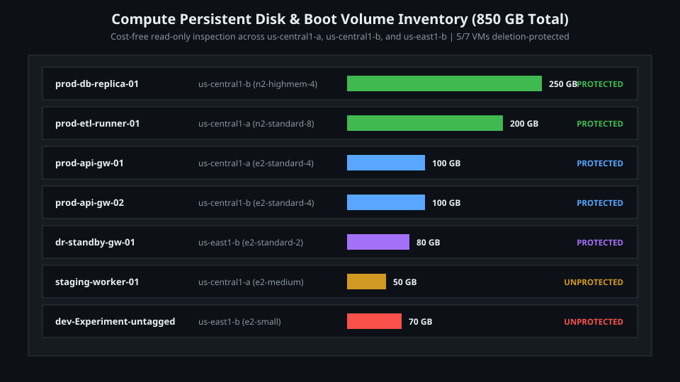<br>*`lmctl https://raw.githubusercontent.com/lmctl-ai/lmgcp/main/examples/27_compute_disk_snapshot_inventory.lms`*<br>Running this example costs about **$0.00** (`estimated cost: $0.00`, read-only; estimated from price table, not yet measured live; prices vary by region). | 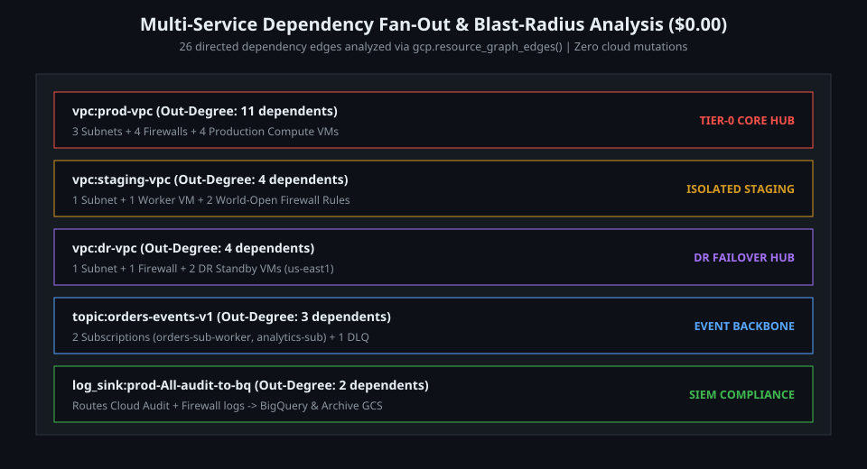<br>*`lmctl https://raw.githubusercontent.com/lmctl-ai/lmgcp/main/examples/39_multi_service_dependency_blast_radius.lms`*<br>Running this example costs about **$0.00** (`estimated cost: $0.00`, read-only; estimated from price table, not yet measured live; prices vary by region). |

### 2. Storage, Messaging, Serverless & Ephemeral Lifecycles

| GCS Bucket Lifecycle & Tiering (`04`) | Pub/Sub Dead-Letter Queue Pipeline (`05`) |
|---|---|
| 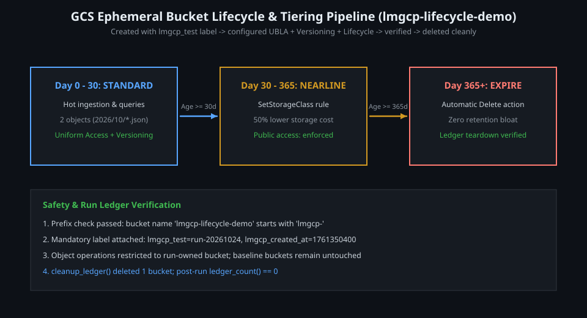<br>*`lmctl https://raw.githubusercontent.com/lmctl-ai/lmgcp/main/examples/04_gcs_bucket_lifecycle_ephemeral.lms`*<br>Running this example costs about **$0.0003** (`estimated cost: $0.0003`, 1 bucket + 2 objects, 2 min alive, 3 requests; estimated from price table, not yet measured live; prices vary by region). | 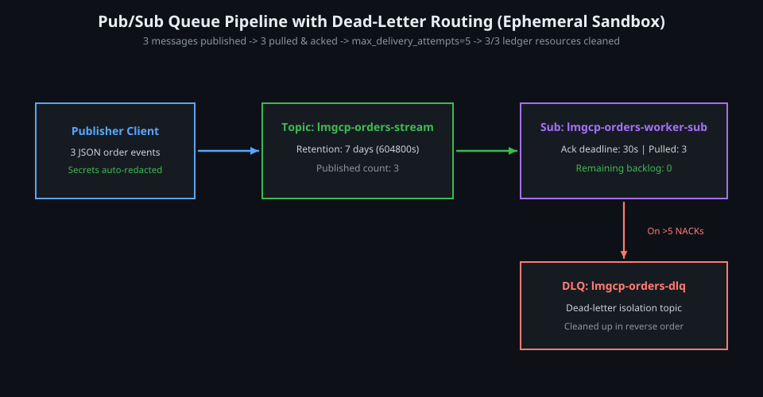<br>*`lmctl https://raw.githubusercontent.com/lmctl-ai/lmgcp/main/examples/05_pubsub_dead_letter_pipeline.lms`*<br>Running this example costs about **$0.0006** (`estimated cost: $0.0006`, 2 topics + 1 sub + 3 messages, 2 min alive, 6 requests; estimated from price table, not yet measured live; prices vary by region). |

| Cloud Run Progressive Canary Rollout (`06`) | Orphaned Resource Sweeper (`--sweep`) (`07`) |
|---|---|
| 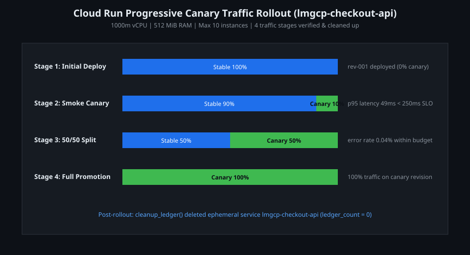<br>*`lmctl https://raw.githubusercontent.com/lmctl-ai/lmgcp/main/examples/06_cloud_run_canary_rollout.lms`*<br>Running this example costs about **$0.0004** (`estimated cost: $0.0004`, 1 Cloud Run service, 2 min alive, 1 request; estimated from price table, not yet measured live; prices vary by region). | 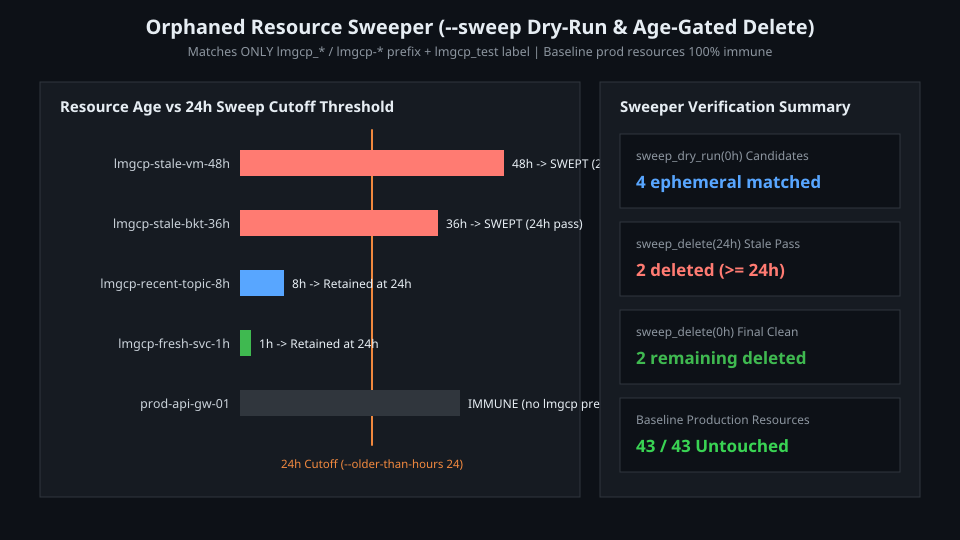<br>*`lmctl https://raw.githubusercontent.com/lmctl-ai/lmgcp/main/examples/07_cleanup_sweeper_dry_run.lms`*<br>Running this example costs about **$0.0015** (`estimated cost: $0.0015`, 1 `e2-micro` VM + 1 bucket + 1 topic + 1 secret, 5 min alive, 4 requests; estimated from price table, not yet measured live; prices vary by region). |

| GCS Partitioned Object Ingestion & Versioning Lab (`29`) | Pub/Sub Multi-Subscriber Fan-Out Pipeline (`30`) |
|---|---|
| 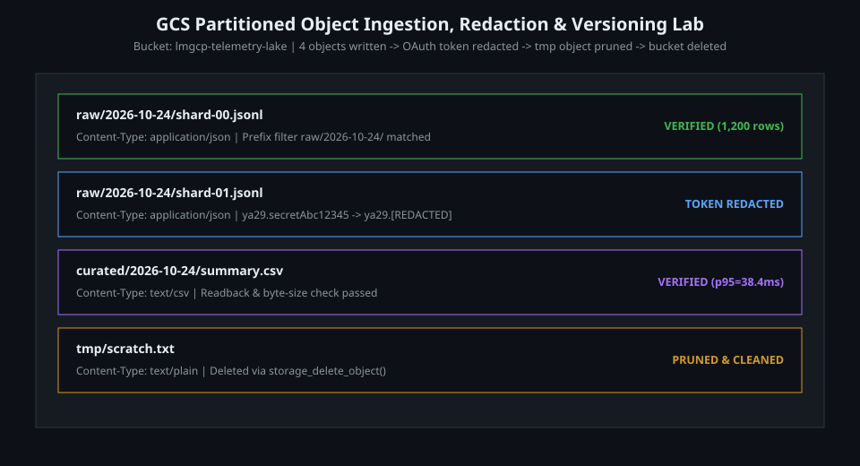<br>*`lmctl https://raw.githubusercontent.com/lmctl-ai/lmgcp/main/examples/29_gcs_object_retention_versioning_lab.lms`*<br>Running this example costs about **$0.0005** (`estimated cost: $0.0005`, 1 bucket + 4 objects, 2 min alive, 5 requests; estimated from price table, not yet measured live; prices vary by region). | 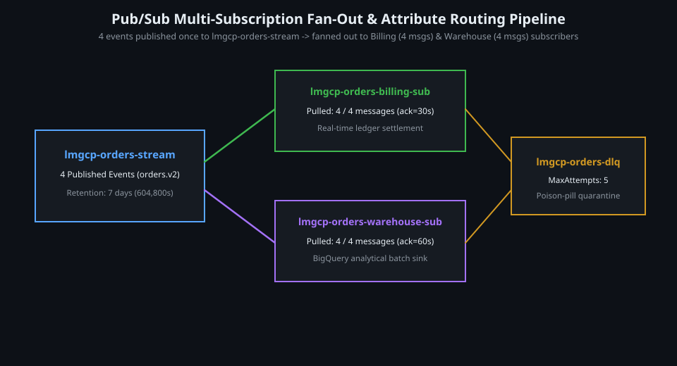<br>*`lmctl https://raw.githubusercontent.com/lmctl-ai/lmgcp/main/examples/30_pubsub_fanout_attribute_routing.lms`*<br>Running this example costs about **$0.0008** (`estimated cost: $0.0008`, 2 topics + 2 subs + 4 messages, 2 min alive, 8 requests; estimated from price table, not yet measured live; prices vary by region). |

| Cloud Run Multi-Region Active-Active Serverless (`31`) | Serverless Event-Driven Mesh (`24`) |
|---|---|
| 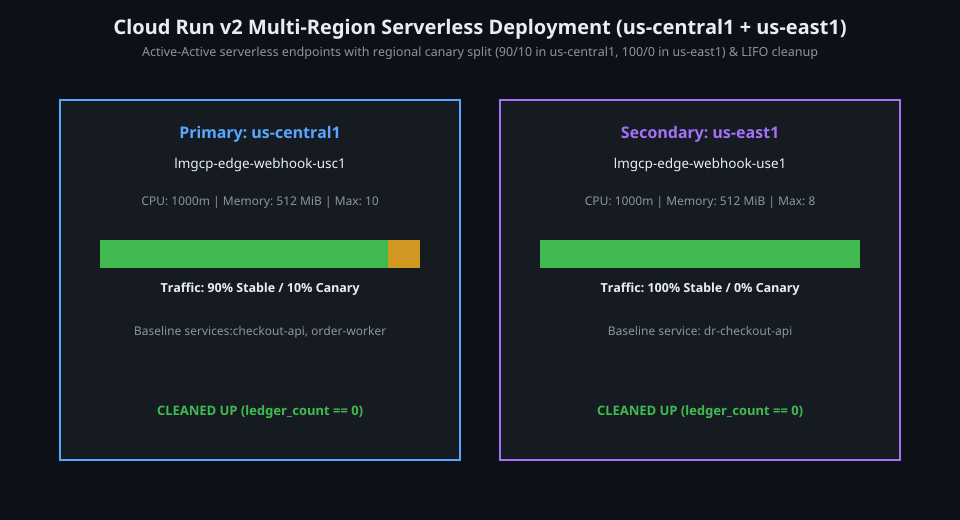<br>*`lmctl https://raw.githubusercontent.com/lmctl-ai/lmgcp/main/examples/31_cloud_run_multi_region_serverless.lms`*<br>Running this example costs about **$0.0008** (`estimated cost: $0.0008`, 2 regional Cloud Run services, 2 min alive, 2 requests; estimated from price table, not yet measured live; prices vary by region). | 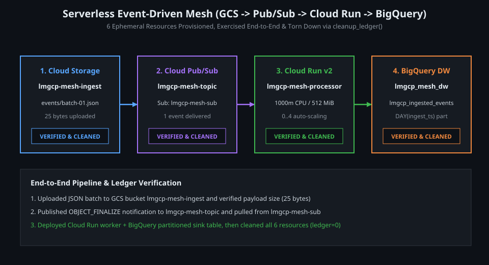<br>*`lmctl https://raw.githubusercontent.com/lmctl-ai/lmgcp/main/examples/24_serverless_event_driven_mesh.lms`*<br>Running this example costs about **$0.0012** (`estimated cost: $0.0012`, 8 serverless resources across Run/PubSub/GCS/BQ/Secrets, 2 min alive, 8 requests; estimated from price table, not yet measured live; prices vary by region). |

### 3. Compute, IAM, Databases & Containers Security Posture

| Compute Engine Fleet Rightsizing (`09`) | IAM Service Account Key & Role Audit (`10`) |
|---|---|
| 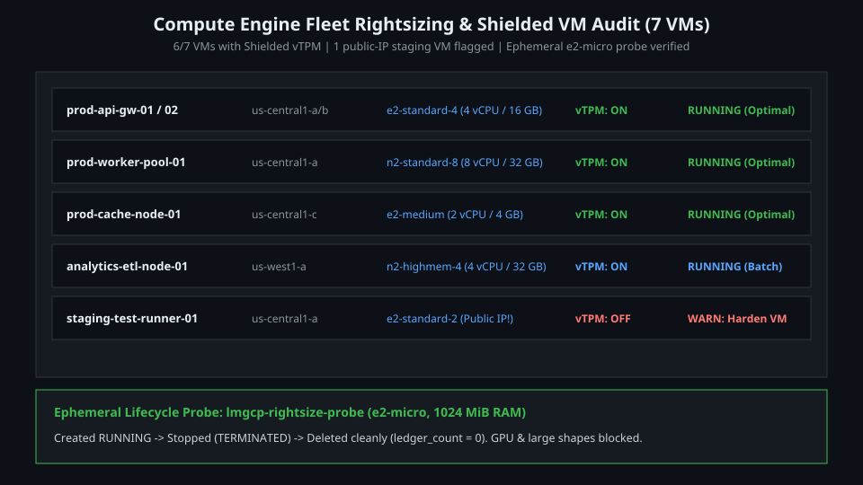<br>*`lmctl https://raw.githubusercontent.com/lmctl-ai/lmgcp/main/examples/09_compute_fleet_rightsizing.lms`*<br>Running this example costs about **$0.0009** (`estimated cost: $0.0009`, 1 `e2-micro` VM, 5 min alive, 1 request; estimated from price table, not yet measured live; prices vary by region). | 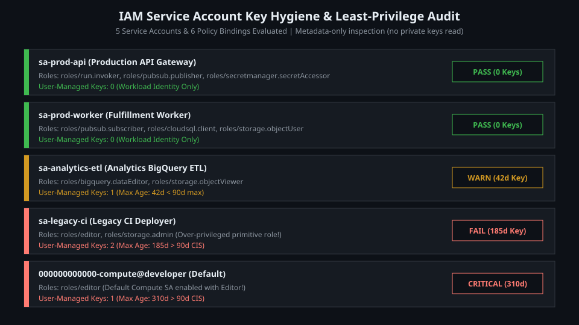<br>*`lmctl https://raw.githubusercontent.com/lmctl-ai/lmgcp/main/examples/10_iam_least_privilege_review.lms`*<br>Running this example costs about **$0.00** (`estimated cost: $0.00`, read-only; estimated from price table, not yet measured live; prices vary by region). |

| Cloud SQL HA, PITR & SSL Posture (`11`) | GKE CIS Cluster Hardening Matrix (`12`) |
|---|---|
| 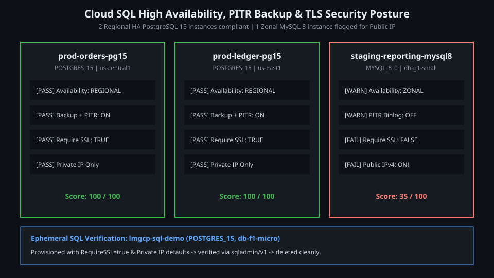<br>*`lmctl https://raw.githubusercontent.com/lmctl-ai/lmgcp/main/examples/11_cloud_sql_ha_backup_posture.lms`*<br>Running this example costs about **$0.0027** (`estimated cost: $0.0027`, 1 `db-f1-micro` SQL instance, 10 min alive, 1 request; estimated from price table, not yet measured live; prices vary by region). | 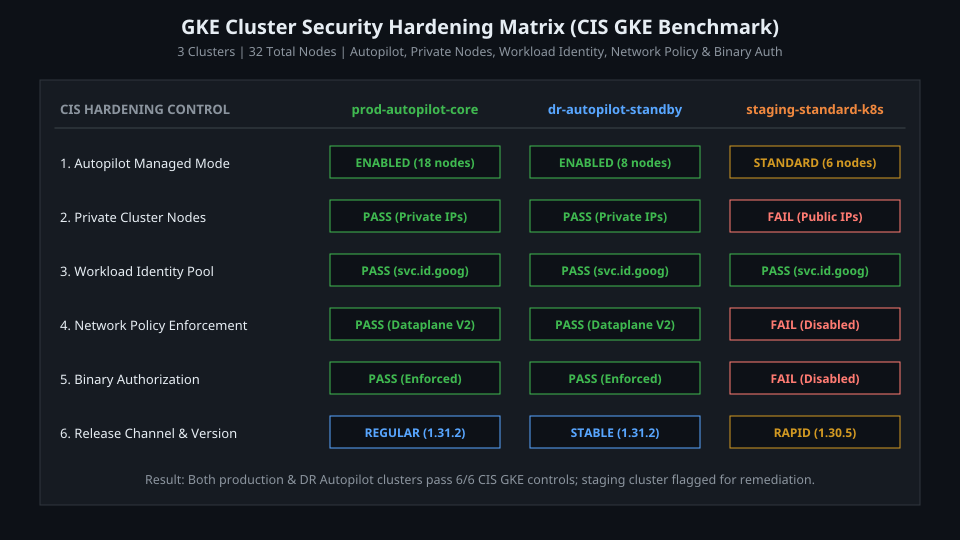<br>*`lmctl https://raw.githubusercontent.com/lmctl-ai/lmgcp/main/examples/12_gke_cluster_hardening_matrix.lms`*<br>Running this example costs about **$0.00** (`estimated cost: $0.00`, read-only; estimated from price table, not yet measured live; prices vary by region). |

| IAM Policy Binding & Blast-Radius Audit (`32`) | Cost-Free CIS Cloud Posture Scorecard (`38`) |
|---|---|
| 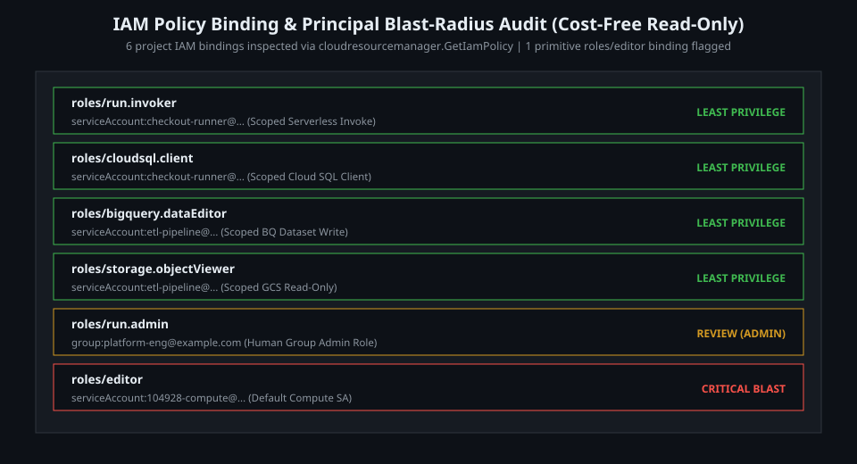<br>*`lmctl https://raw.githubusercontent.com/lmctl-ai/lmgcp/main/examples/32_iam_binding_blast_radius_audit.lms`*<br>Running this example costs about **$0.00** (`estimated cost: $0.00`, read-only; estimated from price table, not yet measured live; prices vary by region). | 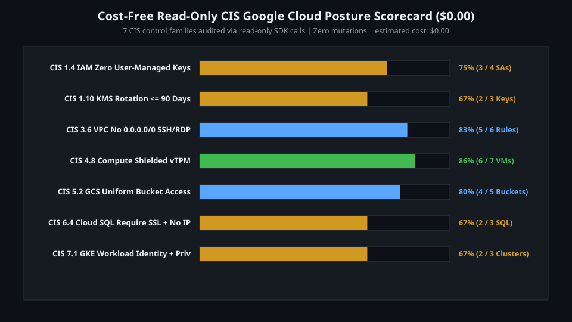<br>*`lmctl https://raw.githubusercontent.com/lmctl-ai/lmgcp/main/examples/38_cost_free_cis_posture_scorecard.lms`*<br>Running this example costs about **$0.00** (`estimated cost: $0.00`, read-only; estimated from price table, not yet measured live; prices vary by region). |

### 4. Secrets, KMS, DNS, BigQuery & Firestore Workflows

| Secret Manager Metadata-Only Audit (`13`) | Cloud KMS Key Rotation & HSM Posture (`14`) |
|---|---|
| 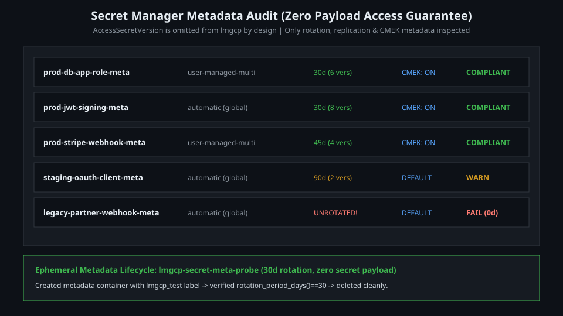<br>*`lmctl https://raw.githubusercontent.com/lmctl-ai/lmgcp/main/examples/13_secret_manager_metadata_audit.lms`*<br>Running this example costs about **$0.0002** (`estimated cost: $0.0002`, 1 secret metadata resource, 2 min alive, 1 request; estimated from price table, not yet measured live; prices vary by region). | 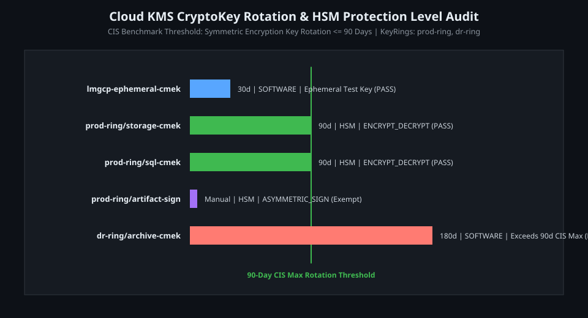<br>*`lmctl https://raw.githubusercontent.com/lmctl-ai/lmgcp/main/examples/14_kms_key_rotation_posture.lms`*<br>Running this example costs about **$0.0010** (`estimated cost: $0.0010`, 1 KMS cryptoKey version, 5 min alive, 1 request; estimated from price table, not yet measured live; prices vary by region). |

| Cloud DNS Split-Horizon & DNSSEC (`15`) | BigQuery Time-Partitioned Warehouse (`16`) |
|---|---|
| 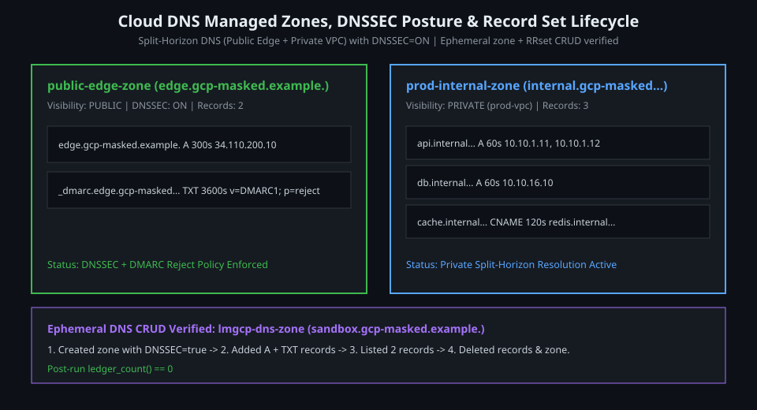<br>*`lmctl https://raw.githubusercontent.com/lmctl-ai/lmgcp/main/examples/15_cloud_dns_zone_records.lms`*<br>Running this example costs about **$0.0009** (`estimated cost: $0.0009`, 1 DNS zone + 2 record sets, 5 min alive, 3 requests; estimated from price table, not yet measured live; prices vary by region). | 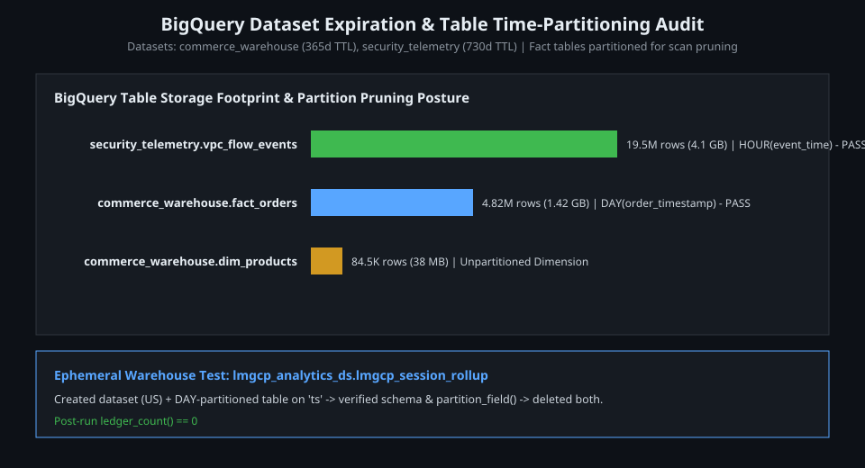<br>*`lmctl https://raw.githubusercontent.com/lmctl-ai/lmgcp/main/examples/16_bigquery_dataset_partition_audit.lms`*<br>Running this example costs about **$0.0003** (`estimated cost: $0.0003`, 1 BQ dataset + 1 partitioned table, 2 min alive, 2 requests; estimated from price table, not yet measured live; prices vary by region). |

| Cloud Firestore Document Workflow (`17`) | BigQuery Multi-Table FinOps Mart (`33`) |
|---|---|
| 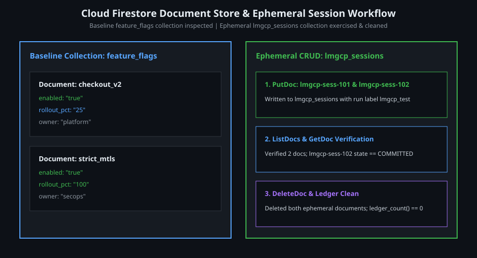<br>*`lmctl https://raw.githubusercontent.com/lmctl-ai/lmgcp/main/examples/17_firestore_document_workflow.lms`*<br>Running this example costs about **$0.0002** (`estimated cost: $0.0002`, 2 Firestore documents, 1 min alive, 2 requests; estimated from price table, not yet measured live; prices vary by region). | 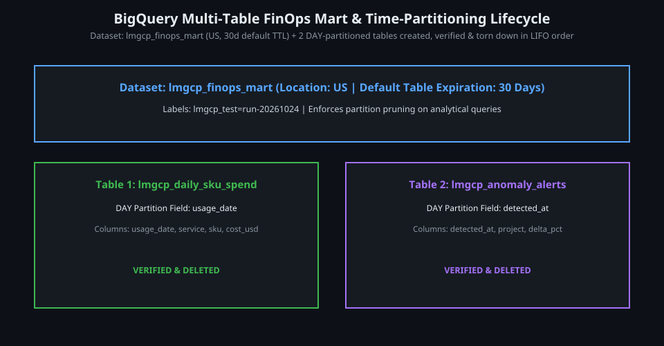<br>*`lmctl https://raw.githubusercontent.com/lmctl-ai/lmgcp/main/examples/33_bigquery_multi_table_warehouse_lifecycle.lms`*<br>Running this example costs about **$0.0005** (`estimated cost: $0.0005`, 1 BQ dataset + 2 partitioned tables, 2 min alive, 3 requests; estimated from price table, not yet measured live; prices vary by region). |

| Firestore Multi-Collection State & Lock Store (`34`) | KMS Multi-KeyRing Envelope Encryption (`35`) |
|---|---|
| 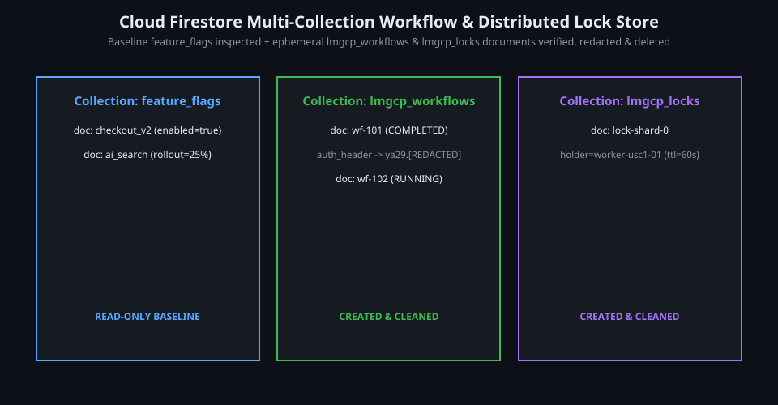<br>*`lmctl https://raw.githubusercontent.com/lmctl-ai/lmgcp/main/examples/34_firestore_multi_collection_state_store.lms`*<br>Running this example costs about **$0.0003** (`estimated cost: $0.0003`, 3 Firestore documents across 2 collections, 1 min alive, 3 requests; estimated from price table, not yet measured live; prices vary by region). | 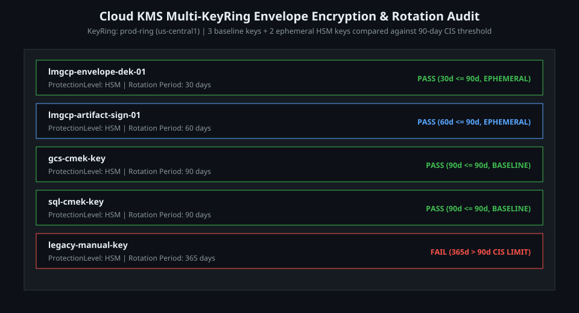<br>*`lmctl https://raw.githubusercontent.com/lmctl-ai/lmgcp/main/examples/35_kms_multi_keyring_envelope_audit.lms`*<br>Running this example costs about **$0.0020** (`estimated cost: $0.0020`, 2 HSM KMS CryptoKeys, 5 min alive, 2 requests; estimated from price table, not yet measured live; prices vary by region). |

| Cloud DNS Microservice Discovery Mesh (`36`) | VPC Firewall Priority & Zero-Trust mTLS Matrix (`28`) |
|---|---|
| 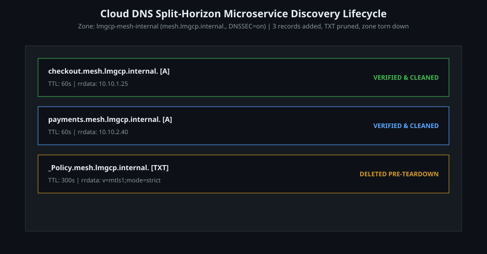<br>*`lmctl https://raw.githubusercontent.com/lmctl-ai/lmgcp/main/examples/36_dns_split_horizon_microservice_mesh.lms`*<br>Running this example costs about **$0.0010** (`estimated cost: $0.0010`, 1 private DNSSEC zone + 3 record sets, 5 min alive, 4 requests; estimated from price table, not yet measured live; prices vary by region). | 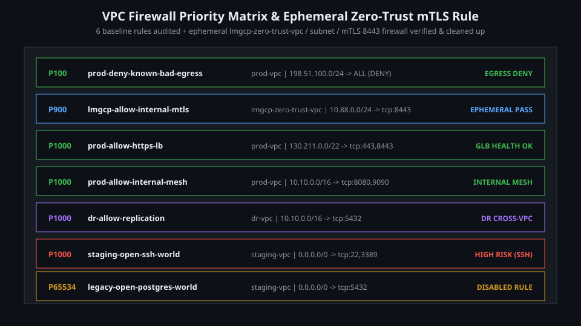<br>*`lmctl https://raw.githubusercontent.com/lmctl-ai/lmgcp/main/examples/28_vpc_egress_ingress_matrix.lms`*<br>Running this example costs about **$0.0004** (`estimated cost: $0.0004`, 1 VPC + 1 subnet + 1 mTLS firewall rule, 2 min alive, 3 requests; estimated from price table, not yet measured live; prices vary by region). |

### 5. Observability, Supply Chain, DR, Cost Ledger & Safety Guardrails

| Cloud Logging Severity & SIEM Routing (`18`) | Cloud Monitoring P95 Latency & SLO Burn (`19`) |
|---|---|
| 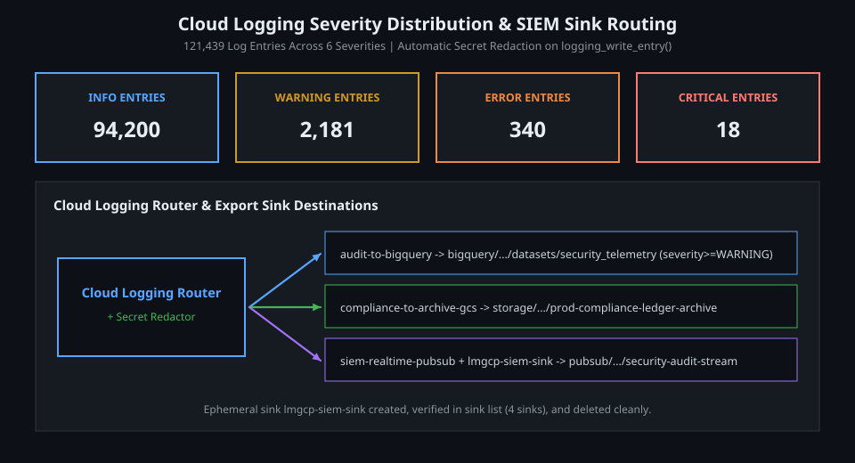<br>*`lmctl https://raw.githubusercontent.com/lmctl-ai/lmgcp/main/examples/18_cloud_logging_sink_routing.lms`*<br>Running this example costs about **$0.0002** (`estimated cost: $0.0002`, 1 log sink + 1 log entry, 2 min alive, 2 requests; estimated from price table, not yet measured live; prices vary by region). | 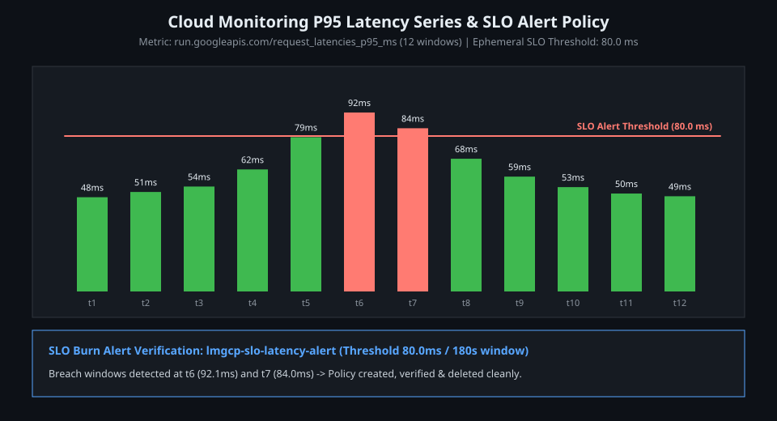<br>*`lmctl https://raw.githubusercontent.com/lmctl-ai/lmgcp/main/examples/19_cloud_monitoring_slo_burn_rate.lms`*<br>Running this example costs about **$0.0002** (`estimated cost: $0.0002`, 1 alert policy, 2 min alive, 1 request; estimated from price table, not yet measured live; prices vary by region). |

| Artifact Registry Supply-Chain Security (`20`) | VPC Subnet CIDR, PGA & Flow Logs (`21`) |
|---|---|
| 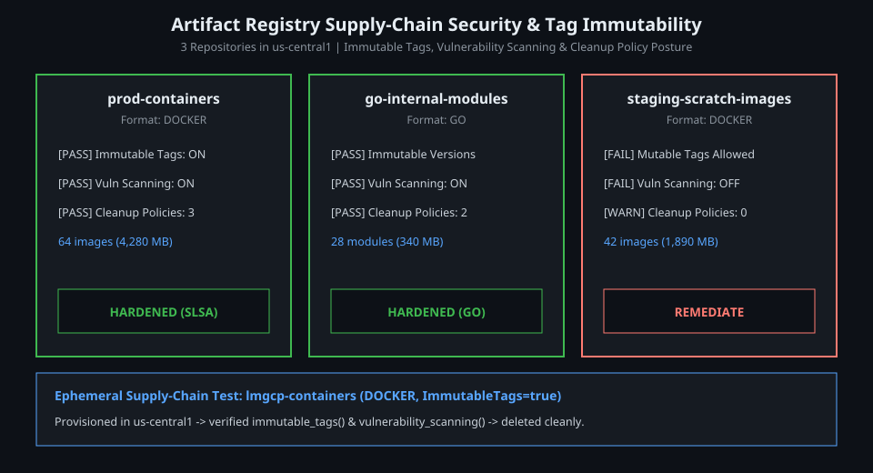<br>*`lmctl https://raw.githubusercontent.com/lmctl-ai/lmgcp/main/examples/20_artifact_registry_supply_chain.lms`*<br>Running this example costs about **$0.0002** (`estimated cost: $0.0002`, 1 Docker repository, 2 min alive, 1 request; estimated from price table, not yet measured live; prices vary by region). | 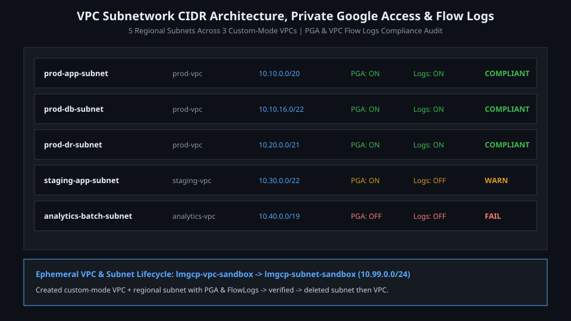<br>*`lmctl https://raw.githubusercontent.com/lmctl-ai/lmgcp/main/examples/21_vpc_subnet_cidr_utilization.lms`*<br>Running this example costs about **$0.0003** (`estimated cost: $0.0003`, 1 VPC + 1 subnet, 2 min alive, 2 requests; estimated from price table, not yet measured live; prices vary by region). |

| Full-Stack Ephemeral Sandbox Teardown (`22`) | GCS Storage Class Tiering & CMEK (`23`) |
|---|---|
| 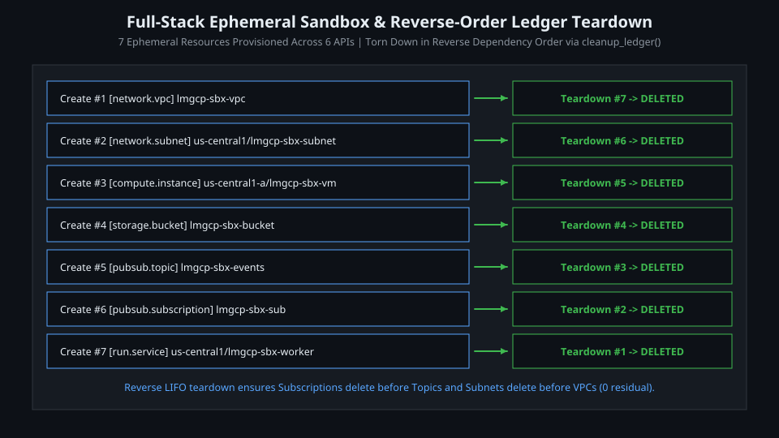<br>*`lmctl https://raw.githubusercontent.com/lmctl-ai/lmgcp/main/examples/22_ephemeral_sandbox_full_stack.lms`*<br>Running this example costs about **$0.0019** (`estimated cost: $0.0019`, 7 resources across VPC/Subnet/Firewall/VM/GCS/PubSub/Run, 5 min alive, 7 requests; estimated from price table, not yet measured live; prices vary by region). | 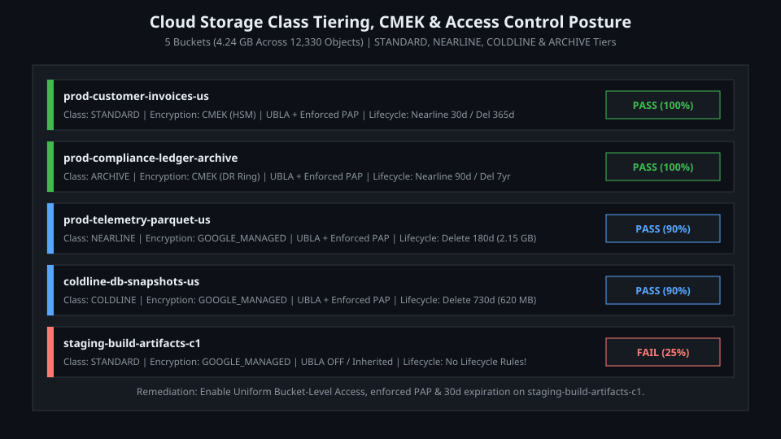<br>*`lmctl https://raw.githubusercontent.com/lmctl-ai/lmgcp/main/examples/23_storage_class_tiering_analysis.lms`*<br>Running this example costs about **$0.00** (`estimated cost: $0.00`, read-only; estimated from price table, not yet measured live; prices vary by region). |

| Multi-Region DR Readiness Scorecard (`25`) | Integrated Logging & Monitoring Incident Pipeline (`37`) |
|---|---|
| 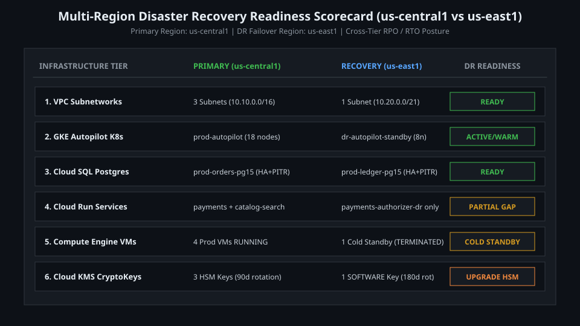<br>*`lmctl https://raw.githubusercontent.com/lmctl-ai/lmgcp/main/examples/25_multi_region_dr_readiness.lms`*<br>Running this example costs about **$0.00** (`estimated cost: $0.00`, read-only; estimated from price table, not yet measured live; prices vary by region). | 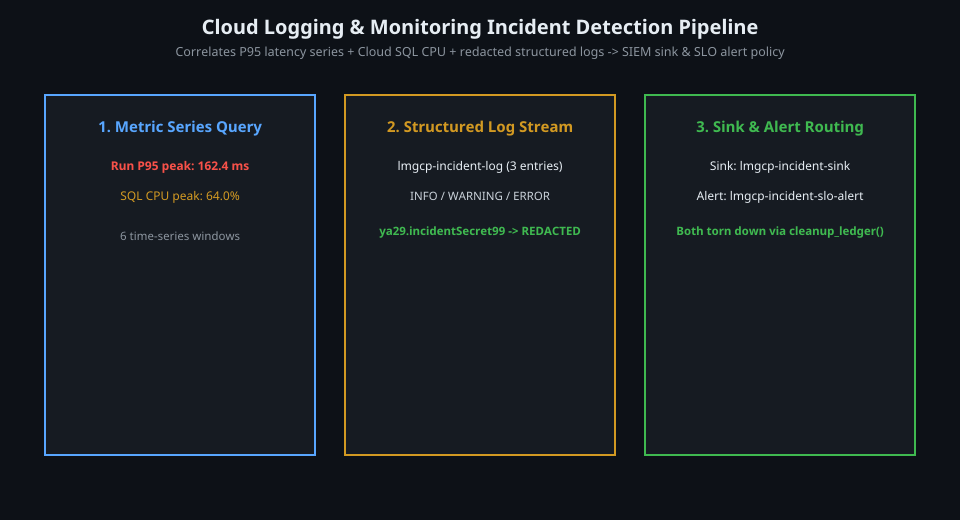<br>*`lmctl https://raw.githubusercontent.com/lmctl-ai/lmgcp/main/examples/37_logging_monitoring_incident_pipeline.lms`*<br>Running this example costs about **$0.0006** (`estimated cost: $0.0006`, 3 log entries + 1 log sink + 1 alert policy, 2 min alive, 5 requests; estimated from price table, not yet measured live; prices vary by region). |

| Cloud Safety & Cost Guardrails Verification (`26`) | RunLedger Cost Trajectory & Cap Readiness Probe (`40`) |
|---|---|
| 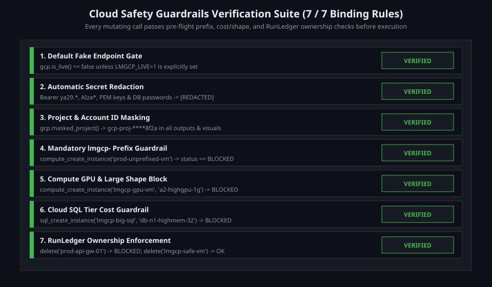<br>*`lmctl https://raw.githubusercontent.com/lmctl-ai/lmgcp/main/examples/26_safety_guardrails_verification.lms`*<br>Running this example costs about **$0.0009** (`estimated cost: $0.0009`, 1 `e2-micro` VM created & deleted + over-cap SQL creation refused at `cap=$0.0020`; estimated from price table, not yet measured live; prices vary by region). | 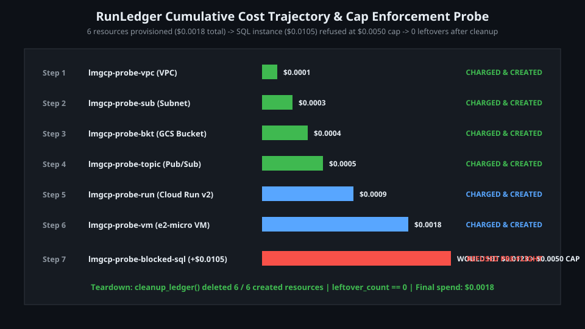<br>*`lmctl https://raw.githubusercontent.com/lmctl-ai/lmgcp/main/examples/40_cost_cap_ledger_live_readiness.lms`*<br>Running this example costs about **$0.0018** (`estimated cost: $0.0018`, 6 resources across VPC/Subnet/GCS/PubSub/Run/VM + over-cap SQL refused at `cap=$0.0050`; estimated from price table, not yet measured live; prices vary by region). |

---

## Cost per Example & Ledger Price Table

Every example in [`examples/`](examples/) measures its own cloud cost using the built-in `RunLedger` price table ([`internal/safety/safety.go`](internal/safety/safety.go)):

- **How the estimate is computed**: Before any mutating SDK call executes (`compute_create_instance`, `sql_create_instance`, `run_deploy_service`, `storage_create_bucket`, `storage_put_object`, `pubsub_create_topic`, `pubsub_publish`, etc.), `RunLedger.ChargeResource(kind, subtype, name, requests)` looks up the resource's public `us-central1` list price (`LookupPrice`)—combining the resource's prorated window cost for `minutes_alive` (5–10 minutes for VMs, SQL, KMS, and DNS zones before automatic `cleanup_ledger()` teardown; 1–2 minutes for serverless/storage/messaging operations) plus per-request API operation charges.
- **Regional & pricing disclaimer**: All estimates use `us-central1` on-demand public list prices (without sustained-use or free-tier discounts so costs are never understated). Live cloud prices vary by region, currency, and billing agreement, and change over time. Numbers in this README are currently **estimated from the ledger price table and not yet measured live**.
- **Per-example cost cap (`$0.05` default / `$0.25` hard ceiling)**: Every run starts with a default cost cap of **`$0.05`** (`gcp.cost_cap_usd()`), configurable via `gcp.set_cost_cap_usd(cap)` up to a hard ceiling of **`$0.25`** per run. If creating the next resource would push `gcp.estimated_cost_usd()` past the cap, the ledger **refuses to create the resource** before any network call is made.
- **End-of-run output & JSON evidence**: Every example prints `estimated cost: $0.00xx (...)` (or `estimated cost: $0.00 (read-only; ...)` for read-only examples) on its final output line via `gcp.cost_report()` and writes a breakdown to `build/evidence/live-cost-<example>.json` via `gcp.write_cost_evidence(...)`.
- **No OIDC and no GCP credentials in CI**: Continuous integration runs 100% against the in-process fake GCP server (`LMGCP_LIVE` unset) with zero cloud credentials or OIDC tokens in GitHub Actions.

---

## Binding Cloud Safety Guardrails

`lmgcp` enforces **8 mandatory safety & cost controls** inside [`internal/safety/`](internal/safety/) and [`internal/host/`](internal/host/):

1. **Fake-by-Default Endpoint Gate**: By default (`LMGCP_LIVE` unset or `0`), `lmgcp` boots an in-process loopback GCP REST emulator (`internal/fakegcp`) and never contacts `*.googleapis.com` or reads ambient `gcloud` credentials. Live GCP calls require explicit `LMGCP_LIVE=1`.
2. **Zero Secret Exposure & Automatic Redaction**: `AccessSecretVersion` is intentionally omitted from the DSL surface (Secret Manager is metadata-only). All strings and errors pass through `safety.RedactSecrets()`, scrubbing `ya29.*` OAuth tokens, `AIza*` API keys, PEM blocks, JWTs, and password parameters into `[REDACTED]`.
3. **Project & Account ID Masking**: `gcp.project()` and `gcp.masked_project()` mask project identifiers (`gcp-proj-****8f2a`) so real project or billing IDs never appear in logs, CSVs, or rendered PNGs.
4. **Mandatory `lmgcp_` / `lmgcp-` Prefix & Run Labels**: Every mutating `create_*` / `deploy_*` call validates that the target resource name begins with `lmgcp_` or `lmgcp-` and attaches `lmgcp_test=<run-id>` and `lmgcp_created_at=<epoch>`.
5. **Compute & SQL Cost/Shape Guardrails**: Only small/free-tier test shapes are permitted (`e2-micro`, `e2-small`, `e2-medium`, `f1-micro`, `g1-small`, `db-f1-micro`, `db-g1-small`, `db-custom-1-3840`). GPU shapes (`a2-*`, `g2-*`) and large shapes (`n2-standard-64`, `db-n1-highmem-32`) are rejected pre-flight.
6. **RunLedger Ownership Enforcement**: Mutating or deleting a resource requires **both** the `lmgcp_` / `lmgcp-` prefix **and** ownership in the current run's `RunLedger`. Pre-existing resources cannot be modified or deleted. `gcp.cleanup_ledger()` tears down all run-owned resources in reverse dependency order (LIFO).
7. **Per-Example Cost Cap (`$0.05` Default / `$0.25` Hard Ceiling)**: The ledger prices every mutating resource and API request before creation and refuses to create the next resource if the running estimate would pass the example's cap.
8. **Prefix search and orphan sweeper**: `gcp.find_prefix("lmgcp")` searches the account-wide fake/live inventory for every name beginning with the supplied prefix. `lmgcp --sweep [--older-than-hours N] [--delete]` remains ledger/tag guarded.

---

## Covered Google Cloud Go SDK Services (16 APIs / 370 DSL Signatures)

| Service Family | Go SDK Package (`google.golang.org/api/...` & `cloud.google.com/go/...`) | DSL Types | Representative Methods on `gcp` Context |
|---|---|---|---|
| **Auth, Safety & Cost** | `cloud.google.com/go/auth`, `cloud.google.com/go/compute/metadata` | `Gcp` | `masked_project`, `auth_mode`, `is_live`, `redact`, `cost_cap_usd`, `set_cost_cap_usd`, `estimated_cost_usd`, `cost_report`, `write_cost_evidence`, `cleanup_ledger`, `sweep_dry_run`, `sweep_delete` |
| **Compute Engine** | `google.golang.org/api/compute/v1` | `ComputeInstance` | `compute_list_instances`, `compute_get_instance`, `compute_create_instance`, `compute_stop_instance`, `compute_delete_instance` |
| **VPC, Subnets & Firewalls** | `google.golang.org/api/compute/v1` | `VpcNetwork`, `Subnet`, `FirewallRule` | `network_list_vpcs`, `network_create_vpc`, `network_list_subnets`, `network_create_subnet`, `network_list_firewalls`, `network_get_firewall` |
| **Cloud Storage (GCS)** | `google.golang.org/api/storage/v1` | `StorageBucket` | `storage_list_buckets`, `storage_create_bucket`, `storage_set_bucket_lifecycle`, `storage_put_object`, `storage_delete_bucket` |
| **Cloud Pub/Sub** | `google.golang.org/api/pubsub/v1` | `PubsubTopic`, `PubsubSubscription` | `pubsub_create_topic`, `pubsub_create_subscription`, `pubsub_publish`, `pubsub_pull`, `pubsub_delete_topic` |
| **Cloud Run v2** | `google.golang.org/api/run/v2` | `CloudRunService` | `run_list_services`, `run_deploy_service`, `run_set_traffic_split`, `run_delete_service` |
| **Cloud SQL** | `google.golang.org/api/sqladmin/v1` | `SqlInstance` | `sql_list_instances`, `sql_get_instance`, `sql_create_instance`, `sql_delete_instance` |
| **Cloud Firestore** | `google.golang.org/api/firestore/v1` | `StrMap` | `firestore_list_collections`, `firestore_put_doc`, `firestore_get_doc`, `firestore_delete_doc` |
| **BigQuery** | `google.golang.org/api/bigquery/v2` | `BqDataset`, `BqTable` | `bq_list_datasets`, `bq_create_dataset`, `bq_create_table`, `bq_get_table`, `bq_delete_dataset` |
| **Cloud IAM** | `google.golang.org/api/iam/v1`, `cloudresourcemanager/v1` | `ServiceAccount` | `iam_list_service_accounts`, `iam_get_service_account`, `iam_list_bindings` |
| **Secret Manager (Meta)** | `google.golang.org/api/secretmanager/v1` | `SecretMetadata` | `secrets_list`, `secrets_get_metadata`, `secrets_create_metadata`, `secrets_delete` |
| **Cloud KMS** | `google.golang.org/api/cloudkms/v1` | `KmsKey` | `kms_list_keyrings`, `kms_list_keys`, `kms_get_key`, `kms_create_key` |
| **GKE (Kubernetes)** | `google.golang.org/api/container/v1` | `GkeCluster` | `gke_list_clusters`, `gke_get_cluster` |
| **Artifact Registry** | `google.golang.org/api/artifactregistry/v1` | `ArtifactRepo` | `ar_list_repositories`, `ar_get_repository`, `ar_create_repository`, `ar_delete_repository` |
| **Cloud DNS** | `google.golang.org/api/dns/v1` | `DnsZone` | `dns_list_zones`, `dns_create_zone`, `dns_add_record`, `dns_list_records`, `dns_delete_zone` |
| **Cloud Logging & Monitoring** | `google.golang.org/api/logging/v2`, `monitoring/v3` | `LogSink`, `AlertPolicy` | `logging_severity_counts`, `logging_create_sink`, `monitoring_query_series`, `monitoring_create_alert_policy` |

---

## Quickstart & CLI Reference

```bash
# Build single native executable
go build -o bin/lmgcp ./cmd/lmgcp

# Inspect CLI flags, version, schema, and 370 DSL signatures
./bin/lmgcp --version
./bin/lmgcp --help
./bin/lmgcp --lmcode-schema --json
./bin/lmgcp --lmcode-signatures
./bin/lmgcp --notices

# Run full offline test suite + all 40 examples (uses in-process fake GCP server)
./test.sh

# Dry-run or execute the orphaned lmgcp-* resource sweeper
./bin/lmgcp --sweep --older-than-hours 1
./bin/lmgcp --sweep --older-than-hours 1 --delete
```

### Optional Live GCP Testing (Requires Explicit Opt-In)

By default, `lmgcp` never touches a live GCP project. See [`docs/LIVE_TESTING.md`](docs/LIVE_TESTING.md) for the complete user-run live testing procedure. To test against a dedicated non-production GCP project:

```bash
export LMGCP_PROJECT="your-sandbox-project-id"
export LMGCP_REGION="us-central1"
export LMGCP_ZONE="us-central1-a"
export LMGCP_LIVE=1

# Verify Application Default Credentials (ADC) are active
gcloud auth application-default print-access-token >/dev/null

# Run read-only inventory & compliance stories against live GCP ($0.00 cost)
lmscript examples/01_project_inventory_overview.lms
lmscript examples/02_label_compliance_audit.lms

# Sweep any orphaned lmgcp-* test resources (dry-run first, then delete)
./bin/lmgcp --sweep --older-than-hours 0
./bin/lmgcp --sweep --older-than-hours 0 --delete
```

### `lmcloud` (OpenTofu) Equivalents & Side-by-Side Comparison (`compare/`)

Every `lmgcp` example (`01` .. `40`) has a 1-to-1 [`lmcloud`](https://github.com/lmctl-ai/lmcloud) (OpenTofu `v1.13.2` host) equivalent under [`compare/<example>/`](compare/) containing:
- `compare/<example>/<example>.lms` — an `lmctl autorun` script using the `tofu.*` DSL API (`init`, `validate`, `plan`, `apply`, `output`, `state_list`, `destroy`),
- `compare/<example>/main.tf` — a `hashicorp/google` provider configuration using the exact same `lmgcp_` / `lmgcp-` resource names, `lmgcp_test` labels, and teardown (`leftovers = 0`).

Run [`./compare/run.sh <example>`](compare/run.sh) (or `./compare/run.sh all`) to execute the native `lmgcp` example and its `lmcloud` equivalent side-by-side and compare resources created, outputs, wall time, estimated cost, and cleanup. See [`compare/RESULTS.md`](compare/RESULTS.md) for the complete 40-example comparison table and architectural analysis.

---

## License

MIT License — see [`THIRD_PARTY_NOTICES`](THIRD_PARTY_NOTICES) for Apache-2.0 and BSD-3-Clause notices of the Google Cloud Go SDK and transitive dependencies.

The compiler minimum is lmscript 0.2.420; the built-in standard is supplied by the SDK and omitted from the host schema.

### External emulator

Set `LMGCP_ENDPOINT=http://127.0.0.1:4588`, `LMGCP_PROJECT=gcpsim-local`,
and optionally `LMGCP_ACCESS_TOKEN=<dummy-token>` to use an external emulator.
The endpoint must be a loopback HTTP origin and cannot be combined with
`LMGCP_LIVE=1`. All SDK requests stay on that origin; redirects and proxies are
not followed. No ADC lookup occurs. The default remains the in-process fake.
GCS upload/download use the SDK when an external endpoint is selected; reads
are limited to 16 MiB. Authentication/permission failures (401/403) are retained
across subsequent operations and make DSL execution fail with an application
error. Configured dummy tokens are redacted from provider errors.
